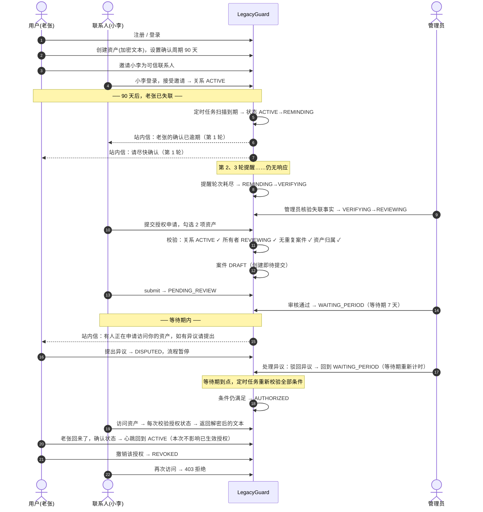
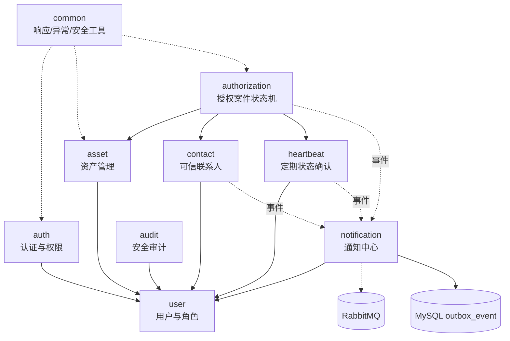

# 01 需求说明书与业务流程

> 第一阶段交付物。本文档只描述"是什么"和"为什么"，不包含实现代码。
> 版本：v1.0（2026-10-28）

## 1.1 项目定位

LegacyGuard 是一个**数字资料托管与应急授权平台**。它解决的不是"人死后怎么继承"这个法律问题，而是一个纯工程问题：

> 用户把敏感资料加密托管在平台，并指定若干可信联系人。当用户长期失联时，系统通过多轮提醒与核验确认这一事实，然后按用户预先设定的意愿，把**特定资产**的访问权交给**特定联系人**。

### 关键边界（v1 明确不做）

| 不做 | 原因 |
| --- | --- |
| 真实遗产继承、公证、法律身份核验 | 需要司法资质，v1 仅模拟流程 |
| 第三方账号接管（代登录微信/银行） | 违反各平台协议 |
| 保存任何可用于认证的身份凭据（密码、银行卡密码、验证码种子、私钥明文） | 平台一旦泄露即造成实质伤害，且托管方无资质 |
| 对象存储（OSS/S3）与文件真实上传 | v1 以"加密文本 + 文件元数据"表达资产，验证链条完整即可 |
| 分布式调度、微服务拆分 | 单体足以承载，引入后只增加复杂度 |

**v1 托管的是"说明性资料"而非"可直接使用的凭据"** —— 例如"我的备份硬盘在书房第二个抽屉，口令提示是……"这类文本。这条边界必须在产品文案上写清楚，否则用户会误以为可以存银行密码。

## 1.2 角色与用例

| 角色 | 身份来源 | 核心用例 |
| --- | --- | --- |
| **普通用户（owner）** | `sys_user.role = USER` | 注册登录、管理资产、邀请联系人、设置确认周期、按时确认、异议、撤销授权、查审计 |
| **可信联系人（contact）** | 同样是 `sys_user.role = USER` | 接受/拒绝邀请、在条件满足时提交授权申请、查看进度、访问已授权资产、提异议 |
| **审核管理员（admin）** | `sys_user.role = ADMIN` | 查待审案件、审批、处理异议、查通知失败任务、查审计 |

**设计决策：联系人与用户是同一张表。** 一个人既是自己资产的所有者，也可能是别人的可信联系人。因此不建独立的"联系人"实体，`trusted_contact` 是 `user → user` 的关系边。

> ⚠️ 待确认（见 `docs/07-待确认事项.md` 第 1 条）：联系人是否必须先注册平台账号。

### 管理员的权限天花板

管理员可以看案件的**元数据**（谁申请了、哪些资产 ID、审批意见），但**不能看资产密文解出的明文**。这条由代码结构保证：管理员相关 Service 不注入解密组件，接口层也不暴露资产内容字段。

## 1.3 端到端主链路

用一条完整的故事把模块串起来（这是理解整个系统最快的路径）：



### 主链路暴露出的六个关键节点

1. **提醒是幂等的** —— 第 N 轮提醒在同一周期内只能生成一次（`dedup_key` 唯一约束兜底）。
2. **超时 ≠ 授权** —— 提醒耗尽只到 `VERIFYING`，还要管理员核验才进 `REVIEWING`。
3. **审批 ≠ 生效** —— `PENDING_REVIEW → WAITING_PERIOD` 是审批，`WAITING_PERIOD → AUTHORIZED` 才是生效，两者相隔一个等待期。
4. **异议能打断** —— 案件进 `DISPUTED` 后，等待期到期任务即使跑到也必须重新校验状态。
5. **访问要实时校验** —— 不能用 Redis 缓存"这个人有权限"来决定放行。
6. **撤销立即失效** —— 撤销写入数据库即为准，下一次访问立刻 403。

## 1.4 业务原则 → 技术约束映射

十条原则不是口号，每条都要在代码里找一个"钉子"钉住：

| # | 业务原则 | 技术落点 |
| --- | --- | --- |
| 1 | 未响应不等于授权 | 心跳最大只推进到 `VERIFYING`；授权案件必须由联系人主动发起 + 管理员审批 |
| 2 | 联系人必须经过验证 | `trusted_contact.status = ACTIVE` 是提交申请的前置条件（Service 层 + 唯一索引双保险） |
| 3 | 授权必须满足明确条件 | `AuthorizationCaseService.assertTransitionAllowed()` 集中式校验，Controller 不得直接改 status |
| 4 | 审批与生效分离 | 状态机中 `WAITING_PERIOD` 是独立状态，由定时任务而非审批接口推进 |
| 5 | 异议必须暂停 | 等待期到期任务用 `UPDATE ... WHERE status = 'WAITING_PERIOD' AND version = ?` 条件更新 |
| 6 | 未授权不得访问 | 资产读取走 `AssetAccessGuard`，每次查数据库中的案件与资产关联，查不到就 403 |
| 7 | 撤销后阻止访问 | 授权状态查询不带长期缓存；撤销事务提交后下一次请求立即失效 |
| 8 | 不得重复执行 | 唯一约束（`dedup_key`、`active_flag` 生成列）+ 消费幂等表 + 条件更新 |
| 9 | MySQL 为准 | Redis 只放验证码、失败计数、限流桶；授权判定一律读库 |
| 10 | 敏感操作留痕 | 状态变更操作与 `audit_log` 写入在同一事务 |

## 1.5 模块划分

模块化单体（modular monolith）：单一 Spring Boot 应用，内部按职责分包，模块间只通过 Service 接口调用，禁止跨模块直接访问对方的 Mapper。



| 模块 | 职责 | 对外暴露 |
| --- | --- | --- |
| `auth` | 登录、注册、JWT 签发、限流、失败锁定 | `AuthService` |
| `user` | 用户资料、角色、状态 | `UserService` |
| `asset` | 资产 CRUD、加密解密、访问守卫 | `AssetService`、`AssetAccessGuard` |
| `contact` | 邀请、关系状态机 | `ContactService` |
| `heartbeat` | 周期计算、确认、到期推进 | `HeartbeatService` |
| `authorization` | 案件状态机、审批、异议、撤销 | `AuthorizationCaseService` |
| `notification` | 站内信、投递任务、出站消息 | `NotificationService` |
| `audit` | 审计写入与查询 | `AuditService` |
| `common` | 统一响应、全局异常、请求 ID、乐观锁工具 | 横切 |
| `infra` | MQ 配置、Redis 配置、调度器、Outbox 发布器 | 横切 |

**依赖方向单向**：`authorization` 依赖其他业务模块，其他业务模块不反向依赖 `authorization`。`heartbeat` 不知道有授权案件这回事，它只负责把状态推到 `REVIEWING`；由 `authorization` 去读心跳状态。

## 1.6 一场业务从创建到关闭的完整数据流

以"创建授权申请"为例，让你知道一次请求会碰哪些表：

```
POST /api/authorizations
  ├─ 读取 trusted_contact          → 校验 status=ACTIVE
  ├─ 读取 heartbeat_confirm_config → 校验 status=REVIEWING
  ├─ 读取 digital_asset            → 校验资产归属 owner 且 status 正常
  ├─ 查询 authorization_case       → 校验无同资产同联系人的有效案件
  └─ 事务内写入：
       ├─ INSERT authorization_case (DRAFT)
       ├─ INSERT authorization_asset (N 行)
       ├─ INSERT audit_log
       └─ INSERT outbox_event (AUTHORIZATION_CASE_CREATED)
  事务提交后 → Outbox 发布器轮询 → 投递到 RabbitMQ → 写 notification
```

每条 INSERT 都必须在同一个 `@Transactional` 里，**消息不是在这里直接发的**，而是先落 `outbox_event`。

## 1.7 本文档的假设

以下假设在后续阶段可调整，但会直接影响表结构，需你确认：

1. 一个人可以既是 owner 又是别人的 contact（同一 `sys_user`）。
2. 一个 owner 可以有多项资产，一个联系人的一次授权申请可以勾选其中任意子集。
3. 第一版一个资产同时只能被一个**有效**案件占用，避免同一份数据被授权给两个人产生冲突。
4. 第一版所有案件都走人工审核，不做"规则自动通过"。
5. 站内信即通知，第一版不发真实邮件/短信，`channel` 字段预留。
