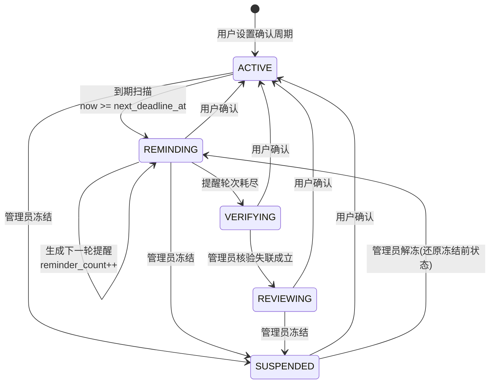
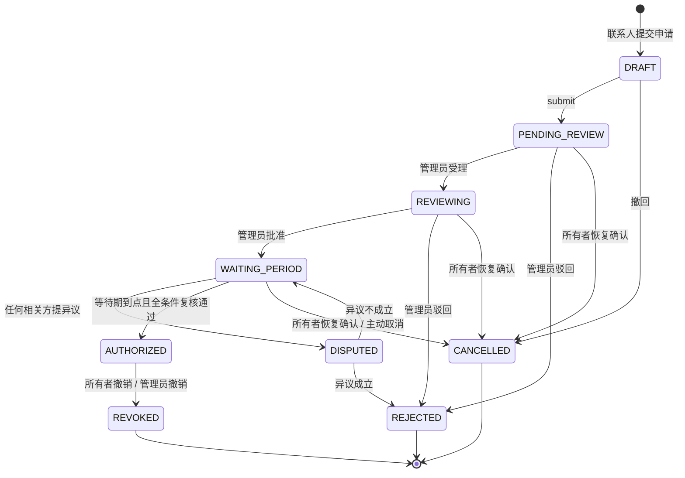
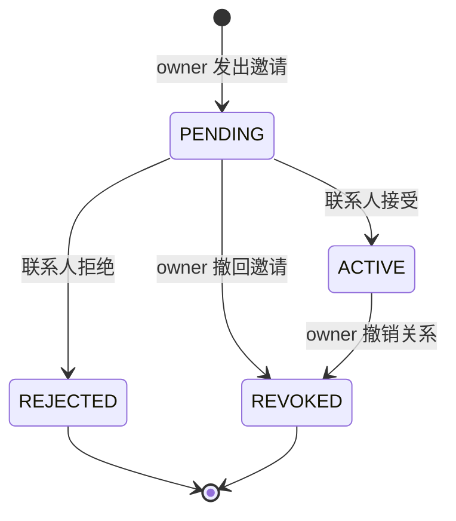

# 02 状态机设计

> 系统里有三个独立状态机。它们之间**没有**共享状态字段，通过读对方的表来判断条件 —— 这是刻意的：耦合越少，并发冲突面越小。

## 2.1 心跳状态机（heartbeat_confirm_config）

这是整个系统的时间基准。"用户还活着"这个事实只由它一个地方维护。



| 状态 | 含义 | 谁会读它 |
| --- | --- | --- |
| `ACTIVE` | 计时中，未逾期 | — |
| `REMINDING` | 已逾期，正在多轮提醒 | 通知模块 |
| `VERIFYING` | 提醒耗尽，等人工核验 | 管理端任务列表 |
| `REVIEWING` | 失联已成立，**允许联系人申请授权** | `authorization` 模块 |
| `SUSPENDED` | 管理员冻结（争议/误判） | 全局（视为不可申请） |

### 转换表

| # | from → to | 触发者 | Guard（必须全部满足） | 副作用（同事务） |
| --- | --- | --- | --- | --- |
| H1 | `ACTIVE` → `REMINDING` | 定时任务 `heartbeatDueScan` | `status='ACTIVE' AND now >= next_deadline_at` | 生成第 1 轮提醒 outbox；`reminder_count=1` |
| H2 | `REMINDING` → `REMINDING` | 定时任务 `heartbeatRemindScan` | `status='REMINDING' AND reminder_count < reminder_rounds AND now >= last_remind_at + interval` | 生成下一轮提醒；`reminder_count++` |
| H3 | `REMINDING` → `VERIFYING` | 定时任务 | `status='REMINDING' AND reminder_count >= reminder_rounds` | 通知管理员有待核验项 |
| H4 | `VERIFYING` → `REVIEWING` | 管理员 | `status='VERIFYING'` | 审计；通知该用户的 ACTIVE 联系人"可提交申请" |
| H5 | 任意非 `ACTIVE` → `ACTIVE` | 用户本人 `POST /heartbeat/confirm` | 请求者 = 配置所有者 | **重置周期**（见 2.1.1）；生成 `heartbeat_record` |
| H6 | 任意非 `SUSPENDED` → `SUSPENDED` | 管理员 | 无 | 审计；记录 `suspended_from_status` |
| H7 | `SUSPENDED` → 原状态 | 管理员解冻 | `status='SUSPENDED'` | 审计 |

### 2.1.1 确认时的重置规则（最容易写错的地方）

一次确认做的事必须**原子完成**：

```
current_cycle_no  += 1
last_confirm_at    = now
next_deadline_at   = now + cycle_days
reminder_count     = 0
last_remind_at     = NULL
status             = ACTIVE
```

同时 `INSERT heartbeat_record(user_id, cycle_no = 旧 cycle_no, confirmed_at, prev_deadline_at, next_deadline_at)`。

**`cycle_no` 是整个幂等体系的主键。** 定时任务每次推进都带上次读到的 `cycle_no`：

```sql
UPDATE heartbeat_confirm_config
   SET status = 'REMINDING', reminder_count = 1, last_remind_at = NOW()
 WHERE user_id = ? AND status = 'ACTIVE' AND cycle_no = ? AND next_deadline_at <= NOW()
```

如果用户在这期间完成了确认，`cycle_no` 已经 +1，这条 UPDATE 影响 0 行，旧任务自然失效 —— **不需要分布式锁，也不需要 synchronized**。

### 2.1.2 为什么超时不能直接授权

`ACTIVE → REMINDING → VERIFYING → REVIEWING` 这条路径上，最后一跳 `VERIFYING → REVIEWING` **必须由人工触发**。这是原则 1 的物理落点：代码里不存在任何一条从 `ACTIVE` 直达"可授权"的边。

## 2.2 授权案件状态机（authorization_case）



| 状态 | 可访问资产 | 是否算"有效案件"（占用资产） |
| --- | --- | --- |
| `DRAFT` | 否 | 是 |
| `PENDING_REVIEW` | 否 | 是 |
| `REVIEWING` | 否 | 是 |
| `WAITING_PERIOD` | 否 | 是 |
| `DISPUTED` | 否 | 是 |
| `AUTHORIZED` | **是**（仅限关联资产） | 是 |
| `REJECTED` | 否 | 否 |
| `CANCELLED` | 否 | 否 |
| `REVOKED` | 否 | 否 |

### 转换表

| # | from → to | 触发者 | Guard | 事务内副作用 |
| --- | --- | --- | --- | --- |
| C1 | `∅ → DRAFT` | 联系人 | ①关系 `ACTIVE` ②owner 心跳 `REVIEWING` ③资产归属该 owner ④资产无其他有效案件 | INSERT case / case_asset / audit / outbox |
| C2 | `DRAFT → PENDING_REVIEW` | 联系人本人 | `status=DRAFT` | audit / outbox |
| C3 | `DRAFT → CANCELLED` | 联系人 / owner | `status=DRAFT` | 审计，`closed_at=now` |
| C4 | `PENDING_REVIEW → REVIEWING` | 管理员 | `status=PENDING_REVIEW` | 写 `authorization_approval` |
| C5 | `PENDING_REVIEW → REJECTED` | 管理员 | `status=PENDING_REVIEW` | 同上 + 必填驳回理由 |
| C6 | `REVIEWING → WAITING_PERIOD` | 管理员 | `status=REVIEWING` | 审批记录；`wait_period_end_at = now + wait_days` |
| C7 | `REVIEWING → REJECTED` | 管理员 | `status=REVIEWING` | 审批记录 + 理由 |
| C8 | `WAITING_PERIOD → DISPUTED` | owner / 该联系人 / 管理员 | `status=WAITING_PERIOD` | 写 `dispute_record(OPEN)`，紧急通知管理员 |
| C9 | `WAITING_PERIOD → AUTHORIZED` | 定时任务 `waitPeriodExpireScan` | **全条件复核**（见 2.2.1） | 审计 / outbox（通知双方） |
| C10 | `WAITING_PERIOD → CANCELLED` | owner 恢复确认 / 主动取消 | `status=WAITING_PERIOD` | 审计 / outbox |
| C11 | `DISPUTED → WAITING_PERIOD` | 管理员 | `status=DISPUTED` 且异议 `OPEN` | 异议置 `RESOLVED`；**等待期重新计时** |
| C12 | `DISPUTED → REJECTED` | 管理员 | 同上 | 异议置 `RESOLVED`；理由必填 |
| C13 | `AUTHORIZED → REVOKED` | owner | `status=AUTHORIZED` | 审计 / outbox；`revoked_at=now` |

### 2.2.1 等待期到点的全条件复核（C9 的 Guard）

这是"授权审批和授权生效是两个阶段"的物理落点。任务执行时**必须**在同一个事务里逐条复查：

| 复核项 | 数据来源 | 不满足时 |
| --- | --- | --- |
| 案件仍是 `WAITING_PERIOD` | `authorization_case` | 影响 0 行 → 静默跳过 |
| 等待期确实已到 | `wait_period_end_at <= now` | 跳过 |
| 所有者心跳仍是 `REVIEWING` | `heartbeat_confirm_config` | 案件 → `CANCELLED` |
| 联系人关系仍是 `ACTIVE` | `trusted_contact` | 案件 → `CANCELLED` |
| 资产全部仍属于该 owner 且未删除 | `digital_asset` | 案件 → `CANCELLED` |
| 不存在 `OPEN` 异议 | `dispute_record` | 案件 → `DISPUTED` |
| 该资产无其他 `AUTHORIZED` 案件 | `authorization_asset` | 案件 → `CANCELLED` |

写入用条件更新收尾，确保并发安全：

```sql
UPDATE authorization_case
   SET status = 'AUTHORIZED', authorized_at = NOW(), version = version + 1, updated_at = NOW()
 WHERE id = ? AND status = 'WAITING_PERIOD' AND version = ?
```

`version = ?` 是读出来的乐观锁版本。若管理员在此期间做了任何变更（例如处理异议），版本已变，这次生效失败。

## 2.3 联系人关系状态机（trusted_contact）



| # | from → to | 触发者 | Guard |
| --- | --- | --- | --- |
| T1 | `∅ → PENDING` | owner | 不得已存在同 pair 的 `PENDING/ACTIVE` 记录；不得邀请自己 |
| T2 | `PENDING → ACTIVE` | 联系人本人 | 邀请未过期 |
| T3 | `PENDING → REJECTED` | 联系人本人 | — |
| T4 | `PENDING/ACTIVE → REVOKED` | owner | — |

### 撤销关系对已生效授权的影响

**v1 规则：已生效的授权不受影响，但所有者可单独撤销该授权。** 理由：联系人关系是"授权资格"，一旦授权已经生成，它是一份独立的意愿表达，不应被关系变更静默地收回。变更关系只阻止**新的**申请。

这与 Q2 的结论一致：已生效授权只能由所有者显式撤销，任何其他路径（关系撤销、用户恢复确认、管理员操作）都不会自动收回它。

## 2.4 三项并发保护的一致性

三个状态机共用的三条铁律：

1. **状态只能通过 `XxxStateMachine.transition()` 修改**。Controller、Mapper、其他 Service 一律不允许 `setStatus(...)` 后直接 update。
2. **每次转换都带乐观锁版本或业务周期号**，并且检查影响行数；`rows == 0` 视为"状态已被他人改变"，抛出 `StateConflictException`（HTTP 409）或静默放弃（定时任务）。
3. **状态变更与审计、outbox 在同一事务**，任一步失败整体回滚。

### 防止"绕过状态机"的工程手段

- `AuthorizationCase` 实体上不提供公开的 `setStatus()`，只提供 `@TableField(update = "false")` 之外的受控方法。
- `AuthorizationCaseMapper` 的 status 更新只允许出现在 `AuthorizationCaseStateRepository` 中，其他包通过 ArchUnit 规则禁止直接引用该 Mapper（第四阶段引入）。
- 所有转换入口写单元测试：从每个状态对所有非法目标状态发起转换，断言必抛异常 —— 9 个状态 × 9 个目标矩阵，测试用例可参数化生成。

## 2.5 状态机的测试矩阵

第二阶段到第三阶段会覆盖以下参数化用例，这里先定义清楚，避免到时漏测：

```
对每个 (fromState, action) 组合：
  若 (fromState, action) 在转换表中存在  → 断言 toState 正确 + 副作用被触发
  若不存在                              → 断言抛 InvalidStateTransitionException 且数据库无变化
```

重点补充的边界用例：

- `REVOKED` 的案件再次调用 `approve` → 必须拒绝
- `DISPUTED` 的案件倒计时到点 → 必须不生效
- 同一 `cycle_no` 的心跳任务执行两次 → 第二次影响 0 行
- `WAITING_PERIOD` 到期前 1 秒提交异议 → 生效任务必须回滚
