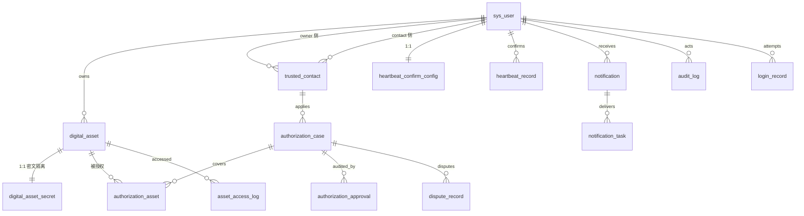

# 03 数据库设计

> 完整建表语句见 [`sql/schema.sql`](../sql/schema.sql)。本文解释设计理由，尤其是那些"为什么不能更简单"的地方。

## 3.1 ER 总览



## 3.2 表职责一览

| 表 | 职责 | 写入频率 | 关键约束 |
| --- | --- | --- | --- |
| `sys_user` | 用户与角色 | 低 | 用户名/邮箱/手机唯一（软删后可复用） |
| `digital_asset` | 资产元数据 | 中 | 归属 owner |
| `digital_asset_secret` | 资产密文（与元数据分表） | 中 | 主键即 asset_id |
| `trusted_contact` | owner→contact 关系边 | 低 | 同一对只能有一条有效关系 |
| `heartbeat_confirm_config` | 每用户一条，状态机核心 | **高**（定时扫描） | 主键 user_id |
| `heartbeat_record` | 确认流水 | 中 | `(user_id, cycle_no)` 唯一 |
| `authorization_case` | 案件主表 | 中 | case_no 唯一；同 owner+contact 只有一条有效 |
| `authorization_approval` | 审批留痕 | 低 | 只增不改 |
| `authorization_asset` | 案件↔资产 | 中 | `(case_id, asset_id)` 唯一 |
| `dispute_record` | 异议 | 低 | — |
| `notification` | 站内信正文 | 高 | `dedup_key` 唯一 |
| `notification_task` | 投递任务与重试 | 高 | 状态+重试时间索引 |
| `outbox_event` | 事务发件箱 | **高** | `event_id` 唯一 |
| `message_consume_record` | 消费幂等 | 高 | `message_id` 唯一 |
| `audit_log` | 审计 | **高** | 无外键、不更新 |
| `asset_access_log` | 资产访问流水 | 高 | — |
| `login_record` | 登录流水 | 中 | — |
| `job_execution_log` | 定时任务执行日志 | 中 | 按 job_name + 时间查询 |

## 3.3 几个需要解释的设计决策

### 3.3.1 为什么要把密文单独拆表

`digital_asset` 存名称、类型、描述、文件元信息；`digital_asset_secret` 存 `cipher_text / iv / key_version / content_hash`。

**理由不是美观，是防止误泄露。** 资产列表页是最常被调用的接口，如果密文和元数据同表，任何一次 `SELECT *`、任何一次 MyBatis-Plus 的 `selectList`、任何一次接口响应序列化，都有把密文带出去的风险（密文本身不可读，但会导致 payload 巨大、日志被撑爆，以及密钥版本信息外泄）。分表之后，列表查询物理上碰不到密文列。

同时这满足了需求 5.2 第 3 条"敏感内容与普通元数据应适当隔离"。

### 3.3.2 用生成列 + 唯一索引表达"条件唯一"

MySQL 的唯一索引不支持 `WHERE` 条件。而业务上我们需要的恰恰是条件唯一：

- 同一 `(owner, contact)` 只能有一条 **PENDING 或 ACTIVE** 的邀请
- 同一 `(owner, contact)` 只能有一条 **未终结** 的授权案件

**错误做法**：把 `status` 放进唯一索引 `UNIQUE(owner_id, contact_user_id, status)`。这样 `REVOKED` 的历史记录会互斥 —— 用户被拒绝两次就再也邀请不了了。

**正确做法**：生成列 + NULL 语义。

```sql
active_key VARCHAR(64) GENERATED ALWAYS AS (
  IF(status IN ('PENDING','ACTIVE'), CONCAT(owner_id, ':', contact_user_id), NULL)
) STORED,
UNIQUE KEY uk_active_pair (active_key)
```

依赖的是 MySQL 的一个特性：**唯一索引允许任意多个 NULL**。有效关系有值 → 互斥；失效关系是 NULL → 不互斥。

同理，`sys_user` 的软删除唯一性也用它：

```sql
username_active VARCHAR(50) GENERATED ALWAYS AS (IF(deleted_at IS NULL, username, NULL)) STORED,
UNIQUE KEY uk_username_active (username_active)
```

否则用户注销后用户名永远被占用。

> 这是本项目在 MySQL 能力上最有含量的一处，面试可直接讲。

### 3.3.3 无法用唯一索引表达的约束：资产跨案件占用

业务要求"一个资产同时只能被一个有效案件占用"，但案件的"有效"取决于 `authorization_case.status`，而资产关联在另一张表 `authorization_asset`，**跨表的条件唯一无法用 MySQL 唯一索引表达**。

处理方式（两层）：

1. **应用层行锁**：创建案件的事务内先对涉及资产执行
   `SELECT id FROM digital_asset WHERE id IN (...) FOR UPDATE`，再查询这些资产是否已存在有效案件关联。行锁保证两个并发请求串行化。
2. **兜底校验**：`WAITING_PERIOD → AUTHORIZED` 生效前的全条件复核（见 02 文档 C9）会再查一次，即使前面漏了也不会重复生效。

**这不是妥协，而是必须显式说明的设计边界。** 面试时被问"为什么这里没有唯一索引"，正确答案是"跨表条件唯一在 MySQL 里没有声明式表达方式，我们用行锁 + 二次复核替代"。

### 3.3.4 外键：保留，但限定范围

| 关系 | 是否建外键 | 理由 |
| --- | --- | --- |
| `digital_asset.owner_id → sys_user.id` | 是 | 数据完整性优先，单体单库，无分库压力 |
| `digital_asset_secret.asset_id → digital_asset.id` | 是，`ON DELETE CASCADE` | 密文脱离元数据毫无意义 |
| `trusted_contact.owner_id / contact_user_id` | 是 | 强一致 |
| `heartbeat_confirm_config.user_id` | 是 | 一对一 |
| `authorization_case.owner_id / contact_id` | 是 | 强一致 |
| `authorization_asset → case / asset` | 是 | 防脏关联 |
| `audit_log.actor_id` | **否** | 用户注销后审计记录必须保留且可读，不能因外键失败或被约束 |
| `login_record.user_id` | **否** | 同上，且登录失败时用户可能不存在 |
| `message_consume_record` | 否 | 独立技术表 |

**判断标准**：这个子行在父行消失后还有没有独立价值。审计与登录流水有，业务数据没有。

同时外键不等于代替应用层校验 —— 外键只保证"指向存在"，不保证"指向正确"。归属校验仍然在 Service 层做。

### 3.3.5 软删除策略：只用在需要的地方

需求 6 明确要求"避免滥用逻辑删除"。本项目只有两张表带 `deleted_at`：

| 表 | 软删 | 理由 |
| --- | --- | --- |
| `sys_user` | ✅ | 用户注销后，其审计记录、历史案件仍需可追溯 |
| `digital_asset` | ✅ | 曾有授权案件引用过，物理删除会破坏历史 |
| 其他所有表 | ❌ | 用 `status` 表达状态，不用 `is_deleted` |

严禁给每张表都加 `is_deleted` —— 那会让每个查询都必须记得带条件，漏一个就是数据错乱。

### 3.3.6 乐观锁字段的分布

只有**存在并发状态竞争**的表才加 `version`：

| 表 | version | 竞争点 |
| --- | --- | --- |
| `authorization_case` | ✅ | 两个管理员同时审批、等待期生效与异议并发 |
| `heartbeat_confirm_config` | ✅ | 用户确认与定时扫描并发 |
| `trusted_contact` | ✅ | 邀请接受与撤回并发 |
| `digital_asset` | ✅ | 编辑覆盖 |
| 其他 | ❌ | 无并发状态竞争，加了是噪音 |

## 3.4 索引设计说明

不写"每个字段都建索引"这种模板。下面只列出**为具体查询路径建的索引**：

| 索引 | 服务的查询 | 为什么这个顺序 |
| --- | --- | --- |
| `sys_user.uk_username_active` | 登录按用户名查 | 唯一，前缀命中 |
| `digital_asset.idx_owner_status (owner_id, status)` | 我的资产列表 | 等值 + 等值，覆盖过滤 |
| `heartbeat_confirm_config.idx_status_deadline (status, next_deadline_at)` | **到期扫描**：`WHERE status='ACTIVE' AND next_deadline_at <= now` | 等值列在前，范围列在后，可用索引范围扫描 |
| `heartbeat_confirm_config.idx_status_remind (status, last_remind_at)` | 提醒扫描 | 同上 |
| `authorization_case.idx_status_created (status, created_at)` | 管理端按状态分页 | 等值 + 排序，避免 filesort |
| `authorization_case.idx_wait_deadline (status, wait_period_end_at)` | **等待期到点扫描** | 同到期扫描 |
| `authorization_case.idx_contact (contact_id, created_at)` | 联系人看自己的案件 | — |
| `notification_task.idx_status_retry (status, next_retry_at)` | **重试扫描** | 同 |
| `outbox_event.idx_status_next (status, next_retry_at)` | **Outbox 轮询** | 同 |
| `audit_log.idx_object (object_type, object_id, created_at)` | "这条案件的所有审计" | 等值 + 等值 + 排序 |
| `audit_log.idx_request (request_id)` | 按请求 ID 串起一条链路 | — |

**共同模式**：所有定时扫描都是 `(状态等值列, 时间范围列)` 的复合索引。这是定时任务设计的通用范式 —— 否则每次扫描都是全表。

### 不建的索引

- 不给 `status` 单独建索引（基数低，且总与时间列一起用）
- 不给 `created_at` 单独建索引（没有按时间倒序全表查询的场景）
- 不给 `description` 全文索引（v1 无搜索需求）

## 3.5 字段命名与类型约定

| 约定 | 说明 |
| --- | --- |
| 主键 | `BIGINT UNSIGNED AUTO_INCREMENT`，不用 UUID 做主键（InnoDB 聚簇索引下随机主键会导致页分裂） |
| 对外标识 | 敏感对象（案件）额外用 `case_no VARCHAR(24)` 暴露给前端与日志，避免自增值泄露业务量 |
| 时间 | 统一 `DATETIME`，由应用生成（不用 `TIMESTAMP`，避免 2038 与时区转换问题）；`audit_log` 用 `DATETIME(3)` 保留毫秒以排序同一请求内的事件 |
| 枚举 | 一律 `VARCHAR` 存字符串常量，不用 `TINYINT` 编码。可读性 > 几字节空间，且 DBA 排查时不用查字典表 |
| 金额 | 本项目无金额 |
| 布尔 | 用 `TINYINT(1)` 或无该字段 |
| JSON | 仅 `outbox_event.payload` 与 `audit_log.detail` 使用，且**不做 JSON 内部查询**，只整体读写 |
| 字符集 | `utf8mb4 / utf8mb4_0900_ai_ci`（MySQL 8 默认，支持 emoji，中文排序正确） |

## 3.6 数据量与容量预估（v1）

| 表 | 预估量级 | 说明 |
| --- | --- | --- |
| `sys_user` | 10³ | 演示项目 |
| `digital_asset` | 10⁴ | 每人 10 条以内 |
| `audit_log` | 10⁶ | 最高频写入，需关注归档 |
| `asset_access_log` | 10⁵ | 每次读取都写 |
| `outbox_event` | 10⁵ | 已发布的会定期清理 |

`outbox_event` 与 `message_consume_record` 需要**按时间分批清理**（保留 7 天），否则无限增长。这一点在第六阶段的运维脚本里落实。
