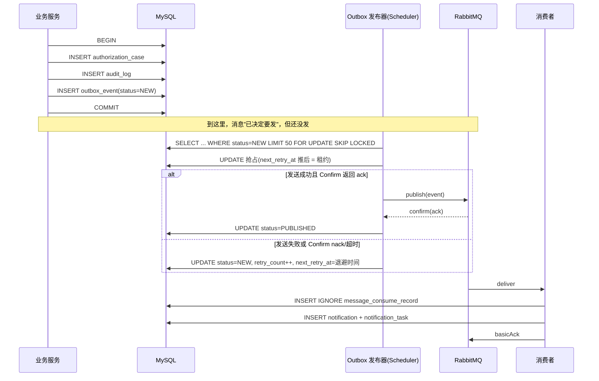

# 05 事务、并发、幂等与消息可靠性

> 这份文档回答一个问题：**当两个请求、两个任务、两次重试同时发生时，系统凭什么还是对的。**

## 5.1 事务边界

### 三条原则

1. **事务只包数据库操作**。任何网络 IO（MQ 推送、HTTP 调用、邮件发送）都不放进 `@Transactional` 方法里。
2. **事务尽可能短**。事务里不做循环 N 次的远程调用，不做大文件处理。
3. **锁的顺序固定**。多表更新时按 `sys_user → digital_asset → authorization_case` 的固定顺序加锁，避免死锁。

### 为什么事务里不能发 MQ

```
@Transactional
void createCase() {
    insert case;          // ①
    rabbitTemplate.send(); // ② 消息发出去了
    insert audit;          // ③
}                          // ④ 如果 ③ 失败，事务回滚
```

结果：**消息已经离开，业务数据被回滚**。消费者收到一条指向不存在案件的"案件已创建"通知。

反过来，先提交再发消息：

```
void createCase() {
    tx { insert case; insert audit; }   // 提交成功
    rabbitTemplate.send();              // 进程在这里崩溃
}
```

结果：**业务数据在，消息永久丢失**，用户永远收不到通知。

**两种顺序都不对。** 所以引入事务发件箱：把"要发消息"这件事本身作为一条数据，和业务数据在同一个事务里落库。

### 各接口的事务边界

| 场景 | 事务范围 | 事务外 |
| --- | --- | --- |
| 注册 | user + audit | — |
| 登录 | login_record 写库 | Redis 计数 |
| 创建资产 | asset + secret + audit + outbox | — |
| 资产读取 | 无事务（只读）+ 访问流水 | — |
| 联系人邀请 | contact + audit + outbox | — |
| 心跳确认 | config + record + 取消案件 + audit + outbox | — |
| 创建案件 | case + case_asset + audit + outbox | — |
| 审批 | case(条件更新) + approval + audit + outbox | — |
| 等待期生效 | 全条件复核 + case(条件更新) + audit + outbox | — |
| 撤销授权 | case + audit + outbox | — |
| 通知消费 | 幂等记录 + notification + task | — |

## 5.2 七个并发场景的解法

### 场景 1：重复提交授权申请

**威胁**：用户连点两次，或前端超时重发，产生两个案件。

**三层防护**：

| 层 | 机制 | 效果 |
| --- | --- | --- |
| 数据库 | `uk_active_case` 唯一索引 | 第二条 INSERT 抛 `DuplicateKeyException` |
| 应用 | 事务内先查无有效案件 | 友好提示 |
| 接口 | `Idempotency-Key` | 5 分钟内同 key 直接返回首次结果 |

```java
try {
    caseMapper.insert(caseEntity);   // 违反 uk_active_case 时抛异常
} catch (DuplicateKeyException e) {
    throw new BizException(ErrorCode.DUPLICATE_CASE);   // → 40902
}
```

**注意**：不要用 `select` 判断后再 `insert` 就完事 —— 两个并发请求可能都查到"不存在"。唯一索引是最终防线，select 只是为了让正常路径有更好的提示。

### 场景 2：两个管理员同时审批

**威胁**：管理员 A 点"批准"，管理员 B 同时点"驳回"，案件可能先被批准又被驳回，或产生两条审批记录。

**解法**：所有状态转换走条件更新，检查影响行数。

```java
int rows = caseMapper.updateStatus(
    caseId,
    "REVIEWING",          // 期望的当前状态
    "WAITING_PERIOD",     // 目标状态
    version               // 读出来的版本号
);

if (rows == 0) {
    throw new StateConflictException();   // → 40901
}
```

对应 SQL：

```sql
UPDATE authorization_case
   SET status = 'WAITING_PERIOD',
       wait_period_end_at = DATE_ADD(NOW(), INTERVAL 7 DAY),
       version = version + 1,
       updated_at = NOW()
 WHERE id = ?
   AND status = 'REVIEWING'
   AND version = ?
```

第二条并发请求的 `version` 已经过期，`rows = 0`，直接回滚。**只有一条审批记录会写入。**

> 为什么不用 `SELECT ... FOR UPDATE` 锁行再判断？也可以，但会持有行锁更久。乐观锁在"冲突概率中等、读多写少"的场景下吞吐更高，而且能天然检测到"别人改过"而不只是"别人锁着"。

### 场景 3：用户确认与定时任务并发

**威胁**：定时任务读到"已到期"，正在准备把状态推到 `REMINDING`；同一瞬间用户点了确认，周期已经重置。如果任务照常推进，刚重置的配置会被错误地标记为逾期。

**解法**：用 `cycle_no` 作为乐观版本。

```sql
-- 定时任务
UPDATE heartbeat_confirm_config
   SET status = 'REMINDING', reminder_count = 1, last_remind_at = NOW(), version = version + 1
 WHERE user_id = ?
   AND status = 'ACTIVE'
   AND cycle_no = ?              -- 任务扫描时读到的周期号
   AND next_deadline_at <= NOW()
```

用户确认时 `cycle_no + 1`，任务的 `cycle_no` 条件不成立 → `rows = 0` → 任务跳过这条记录，不发提醒。

**关键点**：`cycle_no` 比 `version` 更贴切。因为这里要防的是"周期已经换了"，而不是"记录被改过任何字段"。语义更强，日志也更好读。

### 场景 4：等待期结束与异议提交并发

**威胁**：等待期到点的任务正在执行，用户在同一毫秒提交了异议。如果任务先读到"等待期"，然后异议提交成功进入 `DISPUTED`，任务再把它改成 `AUTHORIZED` —— 异议被吞了。

**解法：两道闸门。**

闸门一 —— 生效前在事务内**重新**校验全部条件（不是用扫描时读到的快照）：

```java
@Transactional
void authorizeIfAllConditionsMet(Long caseId) {
    // ① 重新读当前状态（不是扫描时的快照）
    Case c = caseMapper.selectById(caseId);
    if (!"WAITING_PERIOD".equals(c.getStatus())) return;   // 已被改成 DISPUTED

    // ② 逐条复核：异议、心跳、关系、资产
    if (disputeMapper.existsOpen(caseId)) { transitionToDisputed(caseId); return; }
    if (heartbeat.statusOf(c.getOwnerId()) != REVIEWING) { cancel(caseId); return; }
    // ...

    // ③ 条件更新收尾
    int rows = caseMapper.updateStatus(caseId, "WAITING_PERIOD", "AUTHORIZED", c.getVersion());
    if (rows == 0) {
        throw new StateConflictException();   // 事务回滚，静默放弃
    }
}
```

闸门二 —— 异议提交走条件更新：

```sql
UPDATE authorization_case SET status='DISPUTED', version=version+1
 WHERE id=? AND status='WAITING_PERIOD' AND version=?
```

两者谁先提交谁生效，另一个必然 `rows=0`。数据库的行锁保证了这两个 UPDATE 互斥，不需要额外加锁。

> **这就是"授权生效前必须再次检查全部条件"的技术含义** —— 不是业务流程上的重复，而是乐观锁 + 重读实现的互斥。

### 场景 5：消息重复消费

**威胁**：RabbitMQ 在 ack 丢失时会重投，消费者可能收到同一条消息两次。

**解法**：消费记录表 + 唯一约束。

```java
@Transactional
public void onEvent(LegacyEvent event) {
    int rows = consumeMapper.tryRecord(event.eventId());  // INSERT IGNORE
    if (rows == 0) {
        log.info("重复消息已忽略 eventId={}", event.eventId());
        return;                                            // 已处理过，直接返回
    }
    // 正常处理业务
    notificationService.createFrom(event);
}
```

对应 SQL：

```sql
INSERT IGNORE INTO message_consume_record (message_id, queue_name, status)
VALUES (?, 'lg.notify.queue', 'SUCCESS')
```

**幂等记录必须和业务处理在同一事务**：如果记录写入成功但业务处理失败回滚，两者一起回滚，下次重投还能正常处理。

### 场景 6：数据库提交成功但消息发送失败

**解法**：事务发件箱（见 5.3）。

### 场景 7：多个定时任务实例处理同一条记录

**前提**：生产环境部署 2 个实例，两个实例的 `@Scheduled` 会同时触发。

**解法一（本项目采用）**：数据库原子抢占 + 条件更新。

```sql
-- 用 SKIP LOCKED 让多个实例各领各的任务，互不阻塞
SELECT id FROM outbox_event
 WHERE status = 'NEW' AND (next_retry_at IS NULL OR next_retry_at <= NOW())
 ORDER BY id
 LIMIT 50
 FOR UPDATE SKIP LOCKED
```

`SKIP LOCKED` 是 MySQL 8 的特性：被实例 A 锁住的行，实例 B 直接跳过，不会等待，也不会重复读到。

配合后续的 `UPDATE ... WHERE id=? AND status='NEW'` 条件更新，即使有意外重复，也只会有一个实例真正处理。

**解法二（本阶段不引入）**：ShedLock 分布式锁。它会增加一张锁表和一阶依赖，v1 单机部署足够，容器编排阶段再评估。

> 注意需求里说的"不要只使用 Java `synchronized` 解决跨请求的数据库一致性问题"。`synchronized` 只在**同一个 JVM 内**有效，多实例部署直接失效，而且会串行化整个接口的吞吐。本项目一处都不用。

## 5.3 事务发件箱（Transactional Outbox）

### 完整流程



### 抢占为什么不用状态机而用 `next_retry_at`

不用 `NEW → PUBLISHING → PUBLISHED` 三态，因为它需要额外的"僵死状态回收"逻辑（实例崩溃后停在 PUBLISHING 就再也发不出去了）。

改用**租约**：扫描到一条记录后，立刻把 `next_retry_at` 推到 `now + 60s`，然后提交事务，再去发消息。

- 发成功 → `status = PUBLISHED`
- 发失败 → `status = NEW, retry_count++, next_retry_at = 退避时间`
- **实例崩溃** → 60 秒后记录自动重新可被扫描（`next_retry_at <= now`），自愈

代价：极端情况下可能重复发布一次。而重复由消费者幂等吸收 —— 这正是分层设计的价值。

### 退避策略

```
retry_count: 1 → 30s
             2 → 2min
             3 → 10min
             4 → 1h
             5 → 标记 FAILED，进入管理端人工队列
```

## 5.4 RabbitMQ 设计

### 拓扑

```
Exchange: lg.event  (topic, durable)
    │ routing key: heartbeat.remind / contact.invited / case.submitted
    │              case.approved / auth.granted / auth.revoked / dispute.created
    ├──> Queue: lg.notify.queue  (durable, 绑定 lg.event 的 #)
    │        └─ 消费失败 → nack(requeue=false)
    │              ↓ x-dead-letter-exchange: lg.dlx
    └──> DLQ:  lg.notify.dlq     (durable, 绑定 lg.dlx 的 #)

Exchange: lg.dlx  (topic, durable)
```

### 五项可靠性措施的边界

必须先区分这几件事**不是一回事**：

| 事件 | 由什么保证 | 是否等于业务成功 |
| --- | --- | --- |
| 消息发出去了 | `rabbitTemplate.send()` 不抛异常 | ❌ |
| Broker 收到了 | **Publisher Confirm 的 ack** | ❌ |
| 消息被路由到队列 | **`mandatory` + ReturnCallback** | ❌ |
| 消费者处理完了 | 手动 ack | ⚠️ 仅代表消费者不报错 |
| 业务事务提交了 | 消费者内的事务 | ✅ 这个才算 |

**Publisher Confirm 只证明 broker 收下了消息，不证明路由成功。** 如果 routing key 写错，消息会被 broker 丢弃但 confirm 仍然是 ack。所以必须同时开启 `publisher-returns` 并注册 `ReturnsCallback`。

```yaml
spring:
  rabbitmq:
    publisher-confirm-type: correlated
    publisher-returns: true
    template:
      mandatory: true
```

### 消费者可靠性

```java
@RabbitListener(queues = "lg.notify.queue", ackMode = "MANUAL")
public void handle(LegacyEvent event, Message message, Channel channel) throws IOException {
    long tag = message.getMessageProperties().getDeliveryTag();
    try {
        notificationService.handleEvent(event);   // @Transactional
        channel.basicAck(tag, false);
    } catch (IdempotentSkipException e) {
        channel.basicAck(tag, false);             // 重复消息，视为成功
    } catch (Exception e) {
        log.error("消费失败 eventId={}", event.getEventId(), e);
        channel.basicNack(tag, false, false);     // 不重投，进 DLX
    }
}
```

**为什么不 `requeue=true`**：会立刻重新入队，生产环境表现为死循环 + CPU 打满。失败消息进 DLQ，由 `notification_task` 表的退避重试承担真正的"业务重试"。

### 双层重试的分工

| 层 | 负责什么 | 重试方式 |
| --- | --- | --- |
| MQ 层 | 事件不丢失 | 不重投，进 DLQ 留档 |
| 应用层 | 通知业务最终成功 | `notification_task.next_retry_at` + 定时扫描 |

这个分工的意义：**RabbitMQ 只做一次投递**，不用它的重试机制（那会不可控、无法观察）。业务重试完全由自己的表管理，可以在管理端看到每一条失败记录、手动重试。

## 5.5 Redis 使用规范

### Key 设计

| Key | 类型 | TTL | 用途 | 失效影响 |
| --- | --- | --- | --- | --- |
| `lg:login:fail:{username}` | String | 15min | 失败计数 | 无（少算几次失败） |
| `lg:login:lock:{username}` | String | 15min | 临时锁定 | 无 |
| `lg:rate:login:{ip}` | String(INCR) | 1min | IP 限流 | 无 |
| `lg:rate:api:{userId}:{path}` | String(INCR) | 1min | 接口限流 | 无 |
| `lg:captcha:{id}` | String | 5min | 验证码 | 用户需重新获取 |
| `lg:jwt:blacklist:{jti}` | String | = 剩余有效期 | 登出失效 | ⚠️ 登出失效（可接受，token 30min 自然过期） |
| `lg:cache:user:{id}` | Hash | 5min | 用户名/角色（**非敏感**） | 无，回源查库 |
| `lg:idem:{key}` | String | 5min | 幂等键 | 无 |

### 绝对不进 Redis 的东西

- ❌ **案件的授权状态**：`lg:case:{id}:status`
- ❌ **资产是否可访问**
- ❌ **资产明文或密文**

原因：缓存决定授权 = 撤销后仍可能被访问。原则 7 要求"撤销后必须立刻阻止"。

**判断标准**：这个缓存失效会导致**越权**吗？会 → 不能缓存。

### 缓存一致性的两种策略

本项目只用两种，不发明第三种：

| 策略 | 适用 | 做法 |
| --- | --- | --- |
| Cache-Aside + 删缓存 | 用户资料这类读多写少 | 更新 DB 后 `DEL`，下次读回源 |
| 不缓存 | 一切与授权相关的 | — |

**为什么是"删"而不是"更新"缓存**：并发下"先写库后改缓存"与"先读库后回填缓存"可能交错，导致缓存里是旧值。删除是幂等的，最坏只是一次回源。

## 5.6 定时任务清单

所有任务共用的约束：

- 用 `@Scheduled(fixedDelay = ...)` 而不是 `fixedRate`（避免任务堆积）
- 每批次 `LIMIT 200`，用游标 `id > lastId` 分页，**不用 `OFFSET`**
- 单条记录失败不中断整批，记 `job_execution_log.failed_count`
- 每轮执行写一条 `job_execution_log`

| 任务 | 频率 | 扫描条件 | 幂等依据 | 批次 |
| --- | --- | --- | --- | --- |
| `heartbeatDueScan` | 1min | `status=ACTIVE AND next_deadline_at<=now` | `cycle_no` | 200 |
| `heartbeatRemindScan` | 1min | `status=REMINDING AND reminder_count<reminder_rounds AND last_remind_at<=now-interval` | `cycle_no` + `reminder_count` | 200 |
| `waitPeriodExpireScan` | 1min | `status=WAITING_PERIOD AND wait_period_end_at<=now` | `status` + `version` + 全条件复核 | 100 |
| `outboxPublishScan` | 1s | `status=NEW AND next_retry_at<=now` | 状态 + 租约 | 50 |
| `notificationRetryScan` | 1min | `status=FAILED AND next_retry_at<=now` | 状态条件更新 | 200 |
| `heartbeatVerifyTimeoutScan` | 10min | `status=VERIFYING AND updated_at<=now-7d` | 仅告警，不改状态 | 50 |

### 任务的可观测性

每次执行写 `job_execution_log`：

```sql
INSERT INTO job_execution_log
    (job_name, instance_id, status, scanned_count, processed_count, failed_count,
     error_msg, started_at, finished_at, duration_ms)
VALUES (?, ?, ?, ?, ?, ?, ?, ?, ?, ?);
```

管理端可查：任务名、最近执行时间、执行次数、处理记录数、失败数。这是需求 9"任务执行状态可以查询"的落点。

### 一次性任务的"漏跑"恢复

定时任务不保证精确时间。系统重启期间到期的记录不会消失 —— 因为它们的状态仍然满足扫描条件，下一次扫描会一起处理。**这是"任务无状态"的好处：不需要补偿逻辑。**

反例（本设计刻意避免）：
```
for (user in 所有用户) { if (现在 == user.提醒时间) 发提醒 }   // 漏了一秒就永久漏发
```

## 5.7 不变量清单（测试的验收标准）

并发测试断言的不是 HTTP 码，而是下列不变量在任意交错下都成立：

| # | 不变量 | 违反的后果 |
| --- | --- | --- |
| I1 | 任一 `(owner_id, contact_id)` 至多一条未终结案件 | 同一人重复申请 |
| I2 | 任一资产至多被一个 `AUTHORIZED` 案件覆盖 | 同一份数据授权给两人 |
| I3 | 案件状态只能沿状态机迁移 | 业务规则被绕过 |
| I4 | `AUTHORIZED` 案件必然曾经通过 `WAITING_PERIOD` | 跳过等待期 |
| I5 | 案件 `AUTHORIZED` 时，其 owner 心跳必然是 `REVIEWING` | 授权时用户已回归 |
| I6 | 每个 `heartbeat_confirm_config` 同 `cycle_no` 至多一条提醒任务 | 重复轰炸用户 |
| I7 | 同一 `event_id` 至多产生一条有效业务结果 | 重复通知 |
| I8 | `audit_log` 中任何一条关键操作的 `object_id` 必然存在过 | 幽灵审计 |

测试实现方式：并发场景跑完后，用独立的 SQL 直接查数据库断言这些不变量 —— **不经过业务代码**，否则测的是同一套可能已经错的逻辑。
