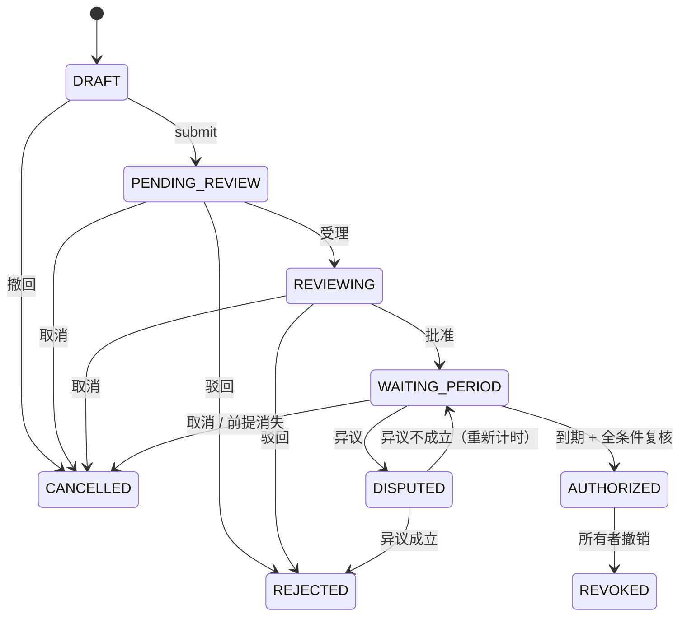

# 14 第三阶段 · 模块五：授权案件状态机

> 这是整个系统权限转移的**唯一通道**。资产从"只有所有者能看"变成
> "某个联系人也能看"，必须完整走完这条链路。

## 14.1 交付接口

### 用户端

| 接口 | 方法 | 权限 | 说明 |
| --- | --- | --- | --- |
| `/api/authorizations` | POST | 联系人（ACTIVE） | 创建草稿 |
| `/api/authorizations` | GET | 已登录 | 我相关的案件 |
| `/api/authorizations/{id}` | GET | 所有者 / 申请人 / 管理员 | 详情（含审批链） |
| `/api/authorizations/{id}/submit` | POST | 申请人 | 提交审核 |
| `/api/authorizations/{id}/cancel` | POST | 所有者 / 申请人 | 取消未生效案件 |
| `/api/authorizations/{id}/disputes` | POST | 所有者 / 申请人 | 提异议（仅等待期） |
| `/api/authorizations/{id}/revoke` | POST | **仅所有者** | 撤销已生效授权 |

### 管理端

| 接口 | 方法 | 说明 |
| --- | --- | --- |
| `/api/admin/authorizations/pending` | GET | 待处理队列 |
| `/api/admin/authorizations/{id}/accept` | POST | 受理 |
| `/api/admin/authorizations/{id}/approve` | POST | 批准 → 等待期 |
| `/api/admin/authorizations/{id}/reject` | POST | 驳回 |
| `/api/admin/authorizations/{id}/resolve-dispute` | POST | 处理异议 |
| `/api/admin/authorizations/scan-expired` | POST | 手动触发等待期扫描（运维） |

**注意管理端没有撤销接口。** 撤销已生效授权是对他人已获得权利的剥夺，
这是所有者专属权利（docs/07 Q4）。

## 14.2 状态机



## 14.3 创建案件的五道前置校验

```java
create() 依次检查：
  ① 联系人关系属于我 且 状态 ACTIVE      → 否则 404 / 422
  ② 所有者心跳处于 REVIEWING             → 否则 422「尚未完成失联核验」
  ③ 资产确实属于该所有者且未删除          → 否则 403
  ④ 资产未被其他进行中的案件占用          → 否则 422
  ⑤ 同一 owner/contact 无其他未终结案件   → 唯一索引 uk_active_case 兜底
```

第 ④ 步的执行方式：先对资产行 `SELECT ... FOR UPDATE`（**固定按 ID 排序加锁**避免死锁），
再查占用情况。跨表条件唯一无法用索引表达，这是 docs/03 第 3.3.3 节说明的补偿方案。

## 14.4 三个"必须检查影响行数"的地方

这是乐观锁唯一可靠的用法 —— **不检查返回值的乐观锁等于没有锁**。

```java
int rows = caseMapper.submit(caseId, expectedVersion);
if (rows == 0) throw new StateConflictException(...);   // 不是"当作成功继续"
```

| 场景 | 并发威胁 | 保护方式 |
| --- | --- | --- |
| 两个管理员同时审批 | 先批准又被驳回 | `WHERE id=? AND status=? AND version=?` |
| 等待期生效 vs 提异议 | 异议被吞 | 同上，谁先提交谁生效 |
| 重复提交/重复批准 | 重复记录 | 同上 + 状态机校验 |

## 14.5 生效前的全条件复核

`authorizeDueCases()` 每处理一个案件都会**重新读库**，而不是相信扫描时的快照。
任何一项前置条件消失，案件就离开 `WAITING_PERIOD`：

| 复核项 | 不满足时 |
| --- | --- |
| 案件仍为 `WAITING_PERIOD` | 静默跳过（被并发改变） |
| 等待期确实已到 | 跳过 |
| 所有者心跳仍为 `REVIEWING` | → `CANCELLED`「所有者已恢复」 |
| 联系人关系仍为 `ACTIVE` | → `CANCELLED`「关系已失效」 |
| 资产仍属于该所有者且未删除 | → `CANCELLED`「资产已变更」 |
| 无未处理异议 | → `DISPUTED` |
| 资产未被其他生效案件覆盖 | → `CANCELLED` |

最后用条件更新收尾；若期间被并发修改，影响 0 行，**放弃本次生效而不是重试**。

## 14.6 异议：审批与生效之间的缓冲

- 只在 `WAITING_PERIOD` 有效，提交即 `DISPUTED`，流程暂停
- 管理员处理时二选一：
  - `UPHELD`（异议不成立）→ 回到等待期，**重新计时**
  - `OVERTURNED`（异议成立）→ 直接驳回

**重新计时**的理由：否则异议可以卡在生效前一刻提交，处理完立刻到点生效，
等于没给所有者任何反应时间。

异议提交与案件状态转换在**同一事务**内：如果案件刚好被并发生效，
这里会抛冲突且异议记录不会留下 —— 不会出现"异议在库里但案件已生效"。

## 14.7 实测结果

### 单元测试

```
AuthorizationCaseServiceTest  17 个用例，全部通过
```

覆盖：五道前置条件（4 个用例）、条件更新 0 行即冲突、终态不可受理、
批准只到等待期、仅所有者可撤销、异议仅限等待期、生效前复核（5 个用例）、
恢复确认批量取消。

### 端到端（完整业务闭环）

| # | 验证项 | 期望 | 实际 |
| --- | --- | --- | --- |
| 1 | 未核验失联时建案 | 422 | ✅ 尚未完成失联核验 |
| 2 | 建案 | 201 DRAFT | ✅ LG-20261028-2P4CGR |
| 3 | 提交审核 | 200 | ✅ |
| 4 | 管理员受理 | 200 | ✅ |
| 5 | 管理员批准 | 200 | ✅ 状态 **WAITING_PERIOD**（不是 AUTHORIZED） |
| 6 | 等待期内访问资产 | 403 | ✅ |
| 7 | 管理员重复批准 | 409 | ✅ |
| 8 | 到期扫描 | 生效 1 个 | ✅ 状态 AUTHORIZED |
| 9 | 生效后访问资产 | 200 | ✅ 内容正确，accessType=CASE_VIEW |
| 10 | 联系人修改资产 | 403 | ✅ 只能读不能改 |
| 11 | 非所有者撤销 | 403 | ✅ |
| 12 | 所有者撤销 | 200 | ✅ |
| 13 | 撤销后访问 | 403 | ✅ 无缓存，立即失效 |

### 异议流程端到端

| # | 验证项 | 实际 |
| --- | --- | --- |
| 1 | 批准后状态 | WAITING_PERIOD |
| 2 | 所有者提异议 | 200，状态 DISPUTED |
| 3 | **争议中触发扫描** | 生效数 = 0，状态仍 DISPUTED —— 异议挡住了生效 |
| 4 | 争议中访问资产 | 403 |
| 5 | 异议不成立 | 200，回到 WAITING_PERIOD，等待期重新计时 |
| 6 | 重复处理异议 | 409 |

## 14.8 面试可讲点

1. 为什么"批准"和"生效"要拆成两个阶段？合并会有什么后果？
2. 生效前为什么要重新读库复核，而不是相信扫描时的数据？
3. 两个管理员同时审批，代码是怎么保证只有一个成功的？
4. 异议处理时为什么等待期要重新计时，而不是延续原截止时间？
5. 为什么管理端没有"撤销授权"接口？
6. 条件更新返回 0 行时，为什么应该抛冲突而不是重试？
